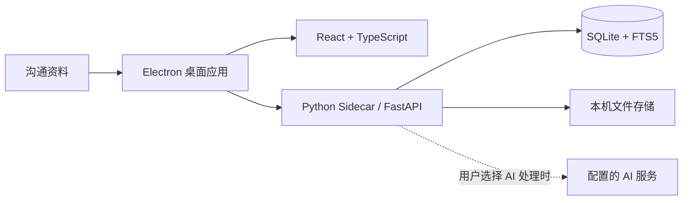

# ClientAtlas

**面向一人公司（OPC）和小型团队的本地优先客户信息工作台。**

ClientAtlas 帮助独立经营者把分散在通话、聊天、邮件和文件中的客户信息，整理到客户与项目脉络中，并把沟通里的需求、决定和下一步行动留下来源依据。

## 项目要解决的问题

客户沟通常常散落在多个工具里。项目背景、需求变更和承诺需要靠记忆或手工翻记录，跟进时容易遗漏上下文。ClientAtlas 将导入资料关联到客户和项目，集中查看沟通时间线，并从原文整理需求与待办。

## 核心能力

- 导入文本、聊天记录、邮件、文档、图片及音视频等沟通资料。
- 按客户和项目整理资料，并在客户 360 页面查看沟通时间线。
- 对支持的资料进行本地解析、OCR 和音频转写；可选择配置 AI 服务生成摘要和需求草稿。
- 将需求、证据来源和销售待办关联起来，支持回看对应原文。
- 使用 SQLite 在本机保存客户资料、导入记录和工作进度。

## 系统结构



应用采用 Windows 桌面架构。Sidecar 负责资料解析、任务处理和本地数据访问；AI 服务为可选配置。

## 本地运行

开发环境：Windows、Node.js 20、pnpm；运行 Python Sidecar 需要 Python 3.11–3.12。

```powershell
pnpm install

# 仅启动前端；Sidecar 不可用时使用内置 Mock 数据
pnpm dev

# 启动 Sidecar + 前端
python -m pip install -r services/ai/requirements.txt
pnpm dev:full

# Electron 桌面开发模式
pnpm electron:dev

# 前端生产构建
pnpm build
```

配置可选 AI 服务时，将 `services/ai/.env.example` 复制为 `services/ai/.env`，再按示例填写配置。不要提交包含真实密钥的 `.env` 文件。

## 隐私与数据处理

客户记录、导入资料和数据库默认保存在本机。用户发起 AI 处理时，所选内容可能会发送到设置中配置的模型服务；使用前请确认资料范围及服务商的数据政策。请勿使用真实客户资料作为公开演示或测试数据。

## 目录结构

```text
electron/       Electron 主进程与 preload
src/            React + TypeScript 界面
services/ai/    Python Sidecar、本地解析与 AI 调用
scripts/        开发、构建和校验脚本
docs/           发布说明
```

## 项目状态与许可

当前代码版本为 `0.3.8`。仓库以 Windows 桌面应用为目标；部分集成需要额外的本机软件或自行配置的 AI 服务。

仓库尚未提供项目级开源许可证，因此公开浏览不代表获准复制、修改或分发。第三方依赖与可选组件各自遵循其上游条款；发布或复用前请核实相关许可。

## English

ClientAtlas is a local-first customer intelligence workspace for solo businesses and small teams. It brings selected conversations and files together under customers and projects, then connects requirements and follow-up tasks to their source material.

Built as a Windows desktop app with Electron, React, TypeScript, a Python sidecar, and SQLite. Optional AI processing uses a provider configured by the user. Customer data and imported files are stored locally by default; selected content may be sent to that provider when an AI action is started.

See the sections above for the architecture and local development commands. This repository currently has no project-wide open-source license. Public visibility does not grant reuse or redistribution rights; check the terms for each dependency and optional component.
